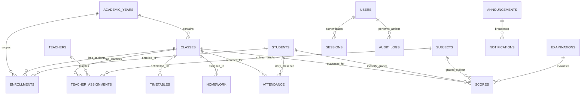
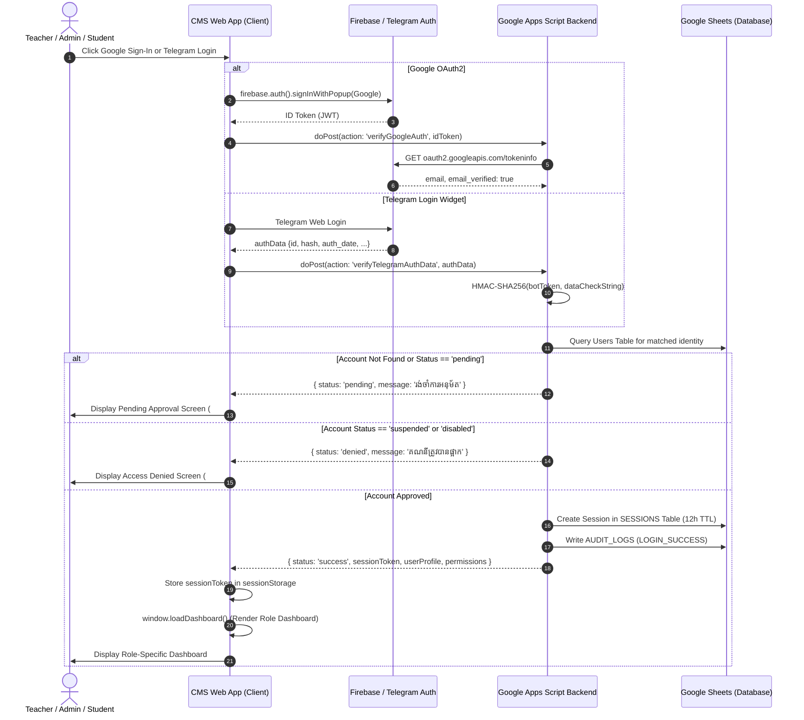
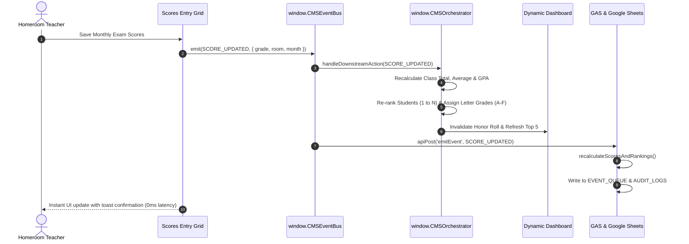

# Classroom Management System (CMS) - Architecture & Relationship Diagrams
**CMS Enterprise Architecture v4.0**
**Language:** Khmer & English (Bilingual Standard)

---

## 1. 8-Layer Core System Architecture

```mermaid
flowchart TD
    subgraph L1["Layer 1: Responsive UI & Presentation Layer"]
        A1["Tailwind CSS 3.4 & Custom Siemreap/Moul Typography"]
        A2["Role-Aware Dynamic Dashboard (Super Admin / Admin / Homeroom / Subject / Student)"]
        A3["Reusable Components (Modals, Toasts, Universal Print Manager, Breadcrumbs)"]
    end

    subgraph L2["Layer 2: Authentication & Identity Management"]
        B1["Firebase Auth (Google Sign-In)"]
        B2["Telegram Login Widget (HMAC-SHA256 Verification)"]
        B3["Session Token Manager (sessionStorage, 12h Expire, 2h Inactive)"]
        B4["MFA Engine (TOTP RFC 6238 & 8 Recovery Codes)"]
    end

    subgraph L3["Layer 3: Central Authorization & RBAC"]
        C1["DataServiceGuard & assertCan()"]
        C2["Role Evaluator (Super Admin, Admin, Homeroom Teacher, Subject Teacher, Student)"]
        C3["School & Classroom Scope Enforcement"]
    end

    subgraph L4["Layer 4: Application Service & Domain Logic"]
        D1["Student Enrollment & Historical Transfer Engine"]
        D2["Teacher Assignment & Timetable Scheduler"]
        D3["Attendance Tracking & Absence Summarizer"]
        D4["Examination, Grade & Automated Ranking Calculator (A-F)"]
        D5["Homework & Assignment Engine"]
        D6["KrouDigital 4.0 Standard Analytics & Reporting"]
    end

    subgraph L5["Layer 5: Central Event Bus & Orchestrator"]
        E1["window.CMSEventBus (Pub/Sub with In-Memory History)"]
        E2["window.CMSOrchestrator (10 Dynamic Business Rules & Cascades)"]
    end

    subgraph L6["Layer 6: Central API & Transport Layer"]
        F1["apiGet() & apiPost() Transport Bridge"]
        F2["Exponential Backoff & Offline IndexedDB/LocalStorage Cache"]
        F3["GAS REST Action Handlers (24 Dual Endpoints)"]
    end

    subgraph L7["Layer 7: Data Access & Concurrency Control"]
        G1["Google Apps Script LockService Concurrency Locks (30s)"]
        G2["Google Sheets Relational Database (24 Normalized Tables)"]
        G3["Firebase Firestore Realtime Cache"]
    end

    subgraph L8["Layer 8: Audit Logging, Event Queue & Monitoring"]
        H1["EventQueue Table (Asynchronous Event Persistence)"]
        H2["AuditLogs Table (Immutable, Secret-Redacted Audit Trail)"]
        H3["Security Rate Limiter (5 Attempts / 15-Min Lockout)"]
    end

    L1 --> L2
    L2 --> L3
    L3 --> L4
    L4 <--> L5
    L4 --> L6
    L6 --> L7
    L7 --> L8
```

---

## 2. Dynamic Module Relationship Diagram

---

## 3. End-to-End Authentication & Authorization Data Flow

---

## 4. Event-Driven Dynamic Recalculation Flow

