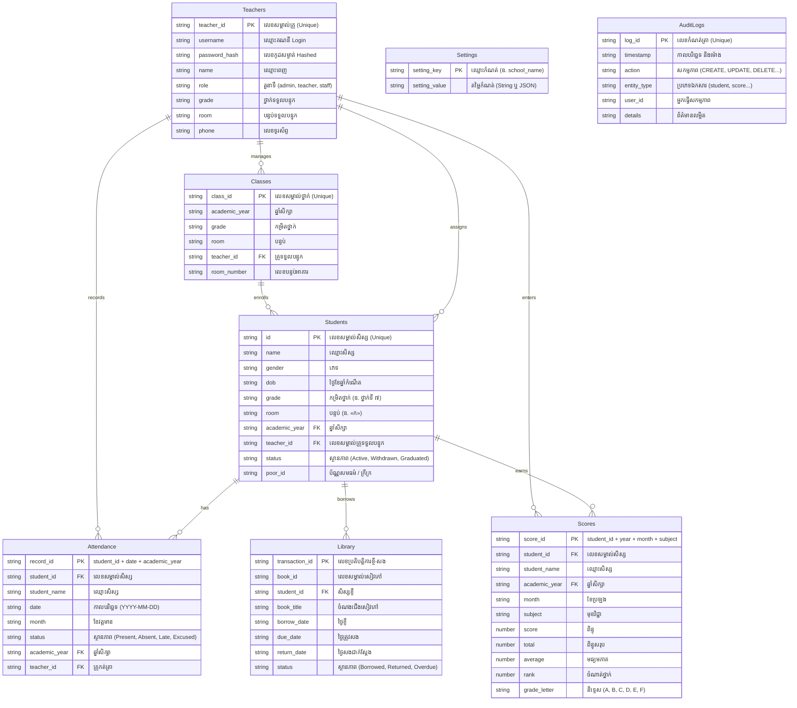

# ឯកសារណែនាំបច្ចេកទេស៖ ប្រព័ន្ធរក្សាទុកទិន្នន័យ Google Sheets & Google Apps Script
## ប្រព័ន្ធគ្រប់គ្រងសាលារៀន (Classroom Management System — CMS)

ឯកសារនេះកំណត់អំពីស្ថាបត្យកម្មទិន្នន័យទំនាក់ទំនង (Relational Database Architecture), វិធីសាស្ត្រតភ្ជាប់ API និងការដាក់ឱ្យប្រើប្រាស់ (Deployment) នៃ Google Sheets & Google Apps Script (GAS) សម្រាប់ជា Cloud Backend / Database បម្រុងទុករបស់ប្រព័ន្ធ CMS។

---

## ១. ស្ថាបត្យកម្មទិន្នន័យទំនាក់ទំនង (Relational Architecture)

ប្រព័ន្ធរក្សាទុកទិន្នន័យលើ Google Sheets ត្រូវបានរៀបចំជាតារាងស្តង់ដារចំនួន ៨ (8 Relational Sheets) ដែលមាន Foreign Keys ភ្ជាប់គ្នាយ៉ាងច្បាស់លាស់ ដូចប្រព័ន្ធ Relational Database (SQL)៖

---

## ២. របៀបតម្លើង និងភ្ជាប់ Google Spreadsheet ជាមួយប្រព័ន្ធ (Step-by-Step Setup)

### ជំហានទី ១៖ បង្កើត Google Spreadsheet ថ្មី
1. ចូលទៅកាន់ [Google Sheets](https://sheets.new) ដើម្បីបង្កើត Google Sheet ថ្មីមួយ។
2. ប្តូរឈ្មោះឯកសារជា៖ `CMS_Classroom_Database` ឬ `ប្រព័ន្ធទិន្នន័យសាលារៀន`។

### ជំហានទី ២៖ បិទភ្ជាប់កូដ Google Apps Script
1. នៅលើ Menu របស់ Google Sheet ចុចលើ **Extensions (ផ្នែកបន្ថែម)** > **Apps Script**។
2. នៅក្នុងផ្ទាំងកូដ សូមលុបកូដចាស់ទាំងអស់ចេញ រួចបើកឯកសារ [`google-apps-script/Code.gs`](./Code.gs) ចម្លង (Copy) យកកូដទាំងអស់មកបិទភ្ជាប់ (Paste) ចូល។
3. ចុចប៊ូតុង **Save (រក្សាទុក)** (រូប Icon Diskette ឬចុច `Ctrl + S`)។

### ជំហានទី ៣៖ បង្កើតតារាងស្តង់ដារស្វ័យប្រវត្តិ
1. ត្រឡប់មកកាន់ផ្ទាំង Google Sheet រួច Refresh (Reload) ទំព័រឡើងវិញ។
2. លោកអ្នកនឹងឃើញ Menu ថ្មីឈ្មោះ **«🏫 CMS ប្រព័ន្ធគ្រប់គ្រងសាលា»** នៅលើរបារ Menu ខាងលើ។
3. ចុចលើ **«🏫 CMS ប្រព័ន្ធគ្រប់គ្រងសាលា»** > **«🛠️ បង្កើត/រៀបចំតារាងស្តង់ដារទាំងអស់»**។
4. Google នឹងសុំការអនុញ្ញាត (Authorization Required) សូមចុច `Continue` > ជ្រើសរើស Gmail របស់អ្នក > ចុច `Advanced` > ចុច `Go to Untitled project (unsafe)` > ចុច `Allow`។
5. ប្រព័ន្ធនឹងបង្កើតតារាងទាំង ៨ ព្រមទាំង Format ពណ៌ និងក្បាលតារាង (Headers) ដោយស្វ័យប្រវត្តិតែម្តង!

### ជំហានទី ៤៖ Deploy ជា Web App
1. នៅលើផ្ទាំង Apps Script ចុចប៊ូតុងពណ៌ខៀវ **Deploy (ដាក់ឱ្យប្រើប្រាស់)** នៅជ្រុងខាងស្តាំខាងលើ > ជ្រើសរើស **New deployment**។
2. ចុចលើរូប Gear (Select type) > ជ្រើសរើស **Web app**។
3. កំណត់ប៉ារ៉ាម៉ែត្រដូចខាងក្រោម៖
   * **Description:** `CMS Production API v2.0`
   * **Execute as:** `Me (អាសយដ្ឋាន Gmail របស់អ្នក)`
   * **Who has access:** `Anyone (អ្នកណាក៏បាន)` *(សំខាន់បំផុត ដើម្បីកុំឱ្យជាប់បញ្ហា Permission នៅពេល CMS បញ្ជូនទិន្នន័យ)*
4. ចុចប៊ូតុង **Deploy**។
5. Copy យក **Web app URL** (មានទម្រង់៖ `https://script.google.com/macros/s/.../exec`)។

### ជំហានទី ៥៖ បញ្ចូល URL ក្នុងប្រព័ន្ធ CMS
1. ចូលទៅកាន់ប្រព័ន្ធ CMS ក្នុងកម្មវិធីរុករក (Browser)។
2. ចូលទៅកាន់ផ្ទាំង **ការកំណត់ (Settings)** > ស្វែងរកផ្នែក **«ការតភ្ជាប់ Google Sheets & Apps Script»**។
3. បិទភ្ជាប់ Web App URL ដែលទើប Copy រួចចុច **«តេស្តការភ្ជាប់ (Test Connection)»**។
4. នៅពេលឃើញសញ្ញា ✅ ជោគជ័យ សូមចុច **«រក្សាទុកការកំណត់»**។

---

## ៣. API Endpoints និង Payload ស្តង់ដារ

### GET Requests (`doGet`)
* `?action=testConnection`: ពិនិត្យសុខភាពប្រព័ន្ធ និងការតភ្ជាប់ API
* `?action=setupSheets`: បញ្ជាឱ្យបង្កើត Sheets ទាំងអស់ពីចម្ងាយ
* `?action=getSettings`: ទាញយកការកំណត់ទូទៅរបស់សាលា
* `?action=getStudents&grade=ថ្នាក់ទី ៧&room=«ក»&academic_year=2026-2027`: ទាញយកបញ្ជីសិស្សតាមថ្នាក់
* `?action=getScores&grade=ថ្នាក់ទី ៧&month=តុលា&academic_year=2026-2027`: ទាញយកពិន្ទុសិស្ស
* `?action=getAttendance&month=តុលា&academic_year=2026-2027`: ទាញយកកំណត់ត្រាវត្តមាន
* `?action=getLibrary`: ទាញយកកំណត់ត្រាខ្ចី-សងសៀវភៅ

### POST Requests (`doPost`)
* `action: "saveStudentsBatch"`: បញ្ជូន និង Upsert បញ្ជីសិស្សទាំងមូល (High Performance Batch Insert)
* `action: "saveScoresBatch"`: បញ្ជូន និង Upsert ពិន្ទុសិស្ស
* `action: "saveAttendanceBatch"`: បញ្ជូន និង Upsert កំណត់ត្រាវត្តមាន
* `action: "saveSettings"`: កត់ត្រាការកំណត់សាលាទៅក្នុងតារាង Settings
* `action: "deleteStudent"`: កំណត់ស្ថានភាពសិស្សជា Withdrawn (Soft Delete)

---

## ៤. សុវត្ថិភាព និងប្រសិទ្ធភាពការងារ (Security & Performance)
1. **LockService:** ការពារបញ្ហា Concurrent Writes នៅពេលមានគ្រូបង្រៀនជាច្រើនបញ្ចូលទិន្នន័យក្នុងពេលតែមួយ។
2. **Bulk Array Operations:** មិនប្រើ `appendRow()` ក្នុង Loop ឡើយ គឺអាន និងសរសេរជា 2D Array ទាំងមូល ជួយឱ្យការ Sync ទិន្នន័យសិស្សរាប់រយនាក់ចំណាយពេលត្រឹមតែ ១-២ វិនាទីប៉ុណ្ណោះ។
3. **Flexible Headers Mapping:** Script ស្វែងរកទីតាំងជួរឈរតាមរយៈឈ្មោះ Header ដោយស្វ័យប្រវត្តិ ដូច្នេះបើអ្នកប្រើប្រាស់ផ្លាស់ប្តូរទីតាំងជួរឈរក្នុង Google Sheet ក៏មិនធ្វើឱ្យប្រព័ន្ធ Error ឡើយ។
